# M0 — Baseline và hợp đồng độ tin cậy

Ngày ghi nhận: 02/10/2026 (Asia/Saigon). Phạm vi: mục 1, 2, 3 của `PLAN_RELIABILITY_1_2_3.md`.

M0 chốt quan sát và hợp đồng cho M1–M6. Chưa thay đổi runtime/API. Bộ fixture ở `tests/fixtures/reliability/` là dữ liệu chuẩn bị cho fault tests các mốc sau; chúng chưa phải kiểm thử thực thi.

## Baseline mã hiện tại

- Source SHA-256 (backend + frontend production source theo `tests/benchmark_baseline.py`): `9243ffd2c09c80493c9d0be61e5933a31667c59ef9067bbcd9df657b28d61c92`.
- Workspace đang là Git repo ClipForge riêng tại `C:/Users/PC/Documents/clipforge`; HEAD khi đo: `ee6b862de49f68fd18e81397e2b44adf2c52660c`. Có năm tài liệu cũ đang bị xóa trong working tree tại thời điểm bắt đầu; M0 không khôi phục hay đưa chúng vào fingerprint.
- Windows 11 build 26200, CPU 12 logical CPU, RAM 15.8 GB; Python 3.13.7, Node 24.14.0, npm 11.9.0, FFmpeg 7.1 (`imageio-ffmpeg` 0.6.0), FastAPI 0.141.1. Lock hash và toàn bộ số đo nằm ở [`M0_BASELINE.json`](M0_BASELINE.json).
- Workload baseline: media tổng hợp `testsrc2` 240×426/15 fps/60 giây; phân tích mặc định; render preview dọc 5 giây, rộng 720; mọi dữ liệu và output ở thư mục tạm.

| Công đoạn | Thời gian | Peak working set process tree | Kết quả |
|---|---:|---:|---|
| Sinh input | 1.50 s | 111.4 MB | H.264, ultrafast CRF 30 |
| Analyze | 2.63 s | 92.7 MB | 20 cảnh, 20 thumbnail / 229,012 B |
| Render lạnh | 10.71 s | 324.4 MB | 480,834 B, `h264_qsv` |
| Render ấm | 4.39 s | 328.5 MB | 1 clip cache hit, 0 miss |

Đây là một lần đo tổng hợp trên máy nêu trên, không đại diện media thật, codec khác, hay resume. Scheduler p95, thời gian phát hiện disconnect và hủy FFmpeg chưa được đo; M6 cần đo trên workload cố định. Benchmark JSON đầy đủ được lưu cùng tài liệu để so sánh.

## Sơ đồ hiện trạng đã đọc từ mã

```mermaid
flowchart TD
  API[POST endpoint thao tác] --> TASK[main.task(pid, kind, operation closure)]
  TASK --> READ[store.read lúc worker bắt đầu]
  TASK --> RESERVE[jobs.reserve: ghi jobs/id.json]
  RESERVE --> POOL[ThreadPoolExecutor, 3 worker]
  POOL --> RUN[closure chạy provider/media/render]
  RUN --> COMMIT[job.commit -> store.save]
  COMMIT --> DONE[ghi job done vào JSON]
  STARTUP[Startup] --> CLEAN[cleanup_staging]
  CLEAN --> LOAD[jobs.initialize]
  LOAD --> INTERRUPTED[queued/running/cancelling -> interrupted]
```

`task()` đọc dự án trước khi reserve nhưng closure đọc lại dự án khi bắt đầu; payload thao tác nằm trong closure. Riêng upload reserve trước khi nhận file, lưu file vào `staging`, sau đó mới launch. `assistant` lưu proposal trong kết quả job nhưng giữ project base trong closure. `render` tạo export rồi thêm metadata export vào project qua commit thông thường. `store.save(operation_id=...)` chỉ gộp history; `Job._commit_done` chỉ tồn tại trong RAM. Startup dọn toàn bộ `staging` trước khi nạp job. `initialize()` đổi trạng thái hoạt động cũ thành `interrupted`, không lưu snapshot hay khả năng resume.

Các điểm gọi job đã thống kê: `analyze`, `plan`, `voice`, `assemble-audio`, `filter-faces`, `transcribe`, `upload`, `template`, `render`, `assistant`, `demo`. Thêm tác vụ mới phải vào registry/payload chung; không thêm call-site closure ngoài scheduler sau M1.

## Sơ đồ đích và hợp đồng trạng thái

```mermaid
stateDiagram-v2
  [*] --> queued
  queued --> running
  queued --> cancelled
  queued --> paused
  running --> paused: tại ranh giới bước
  running --> cancelling
  cancelling --> cancelled
  running --> blocked: đầu vào / tài nguyên / outcome không rõ
  interrupted --> queued: người dùng xác nhận resume
  paused --> queued: người dùng resume
  blocked --> queued: sửa nguyên nhân và revalidate
  running --> done: validate + commit receipt
  running --> error: lỗi đã phân loại
  running --> interrupted: process chết
  done --> [*]
  error --> [*]
  cancelled --> [*]
```



Job bền vững tối thiểu: `schema_version`, `id`, `pid`, `kind`, `operation_version`, `payload`, `input_revision`, `input_fingerprint`, `snapshot_ref`, `attempt`, `state_version`, `status`, `phase`, `steps`, `blocked_reason`, `error`, `commit_token`, `parent_job_id`, timestamps, progress và số liệu an toàn. `state_version` tăng đơn điệu mỗi lần thay đổi trạng thái; state-changing request cần `expected_state_version` và `idempotency_key`. Một job chỉ có một lease/attempt chạy.

| Luồng | Payload cố định khi submit | Ranh giới checkpoint dự kiến |
|---|---|---|
| `render` | `preview`, output profile, renderer/encode config ref + fingerprint | preflight → proxy → từng clip → video join → source audio → subtitle/mix → encode/mux → validate → commit |
| `analyze` | `use_ai`, model/profile ref, prompt version, analyzer version | metadata → từng source scenes → thumbnail → từng AI batch → commit |
| `plan` | `use_ai`, strategy/preset/version và profile ref | snapshot → analysis/AI nếu dùng → timeline → validate → commit |
| `voice` | voice/model/profile ref, normalized settings, script fingerprint | từng câu TTS → normalize/duration → voice join → cues → validate → commit |
| `transcribe` | `asset_id`, ASR profile/model ref, language/settings | audio normalize → ASR → validate → commit |
| `assemble-audio` | assembly version + audio config fingerprint | per-track normalize → mix → validate → commit |
| `filter-faces` | filter version/config fingerprint | per source/clip analysis → replacement map → validate → commit |
| `template` | reference asset id + use_ai/profile ref | source analysis → template inference/build → validate → commit |
| `upload` | role, filenames/sizes, auto-assemble intent, request id | receive complete file → upload manifest → per-file probe/thumb → asset commit |
| `assistant` | revision, prompt fingerprint, model/profile ref | provider intent → persisted proposal → no project commit until separate apply |
| `demo` | demo options/version | demo-specific step list or explicitly non-resumable legacy adapter |

Không lưu API key, Authorization, prompt thô, transcript hay media trong job metadata/diagnostic. `profile_id`/model/config fingerprints nhận diện cấu hình, còn secret chỉ đọc từ settings khi chạy. Fingerprint dùng SHA-256 trên JSON UTF-8 chuẩn hóa (key sort, separator ổn định) gồm `kind`, `operation_version`, phần snapshot dự án có liên quan, `input_revision`, payload chuẩn hóa, fingerprint cấu hình/model/font/renderer và danh sách asset ID + hash nội dung. Bỏ timestamp, progress, attempt, secret và trường UI không ảnh hưởng đầu ra. Asset hash được tính/cache lúc import hoặc xác thực, không trong polling.

Đổi input/config invalidates đúng bước phụ thuộc cùng phần sau của DAG. Checkpoint chỉ tái sử dụng khi schema, operation/algorithm version, input fingerprint, file hash và validator tương ứng còn đúng. File tồn tại/không rỗng không đủ. Snapshot tham chiếu asset bằng ID/hash; không sao chép cả thư viện media.

## API và lỗi thống nhất

Giữ tương thích các endpoint hiện hành: `GET /api/jobs?pid=...`, `POST /api/jobs/{id}/cancel`. Bổ sung hợp đồng theo resource job: `GET /api/jobs/{id}` (chi tiết + kế hoạch resume), `POST /api/jobs/{id}/resume`, `/retry`, `/pause`, `GET /api/jobs/queue`, `POST /api/jobs/queue/{id}/move`, `/pause`, `/resume`, `GET /api/resources`, và `POST /api/diagnostics` + download ID trả về. POST trạng thái yêu cầu idempotency key và state version; vẫn giữ Host/Origin và kiểm tra quyền file hiện hành. Job legacy thiếu snapshot trả `resume_capability: "restart_only"` và giải thích, không giả vờ tiếp tục.

```json
{
  "code": "DISK_SPACE_LOW",
  "category": "resource",
  "message": "Ổ đĩa tạm không đủ dung lượng để tiếp tục.",
  "severity": "error",
  "job_id": "job-id-or-null",
  "step_id": "encode-or-null",
  "retryable": false,
  "actions": ["open_storage", "recheck_storage"],
  "diagnostic_id": "opaque-id-or-null",
  "safe_details": {"volume_role": "temporary", "required_bytes": 0},
  "occurred_at": "2026-10-02T00:00:00Z",
  "detail": "Thông điệp tương thích API cũ"
}
```

Các thuộc tính ngoài `detail` là envelope chuẩn; `actions` phải nằm trong whitelist frontend/backend. `safe_details` là allowlist theo code lỗi, không chứa path cá nhân, URL query, prompt, nội dung project/media hay provider body. Duy trì `detail` trong giai đoạn chuyển đổi. HTTP mapping: validation 400/422; missing 404; revision/state conflict 409; quota/rate/space theo code có thể hành động; internal 500 với message ngắn và `diagnostic_id`. Không biến lỗi poll/network thành job error.

Các mã M0 chốt: `DISK_SPACE_LOW`, `DISK_FULL`, `MEDIA_MISSING`, `MEDIA_CHANGED`, `MEDIA_INVALID`, `PROVIDER_AUTH`, `PROVIDER_QUOTA`, `PROVIDER_RATE_LIMIT`, `PROVIDER_OUTCOME_UNKNOWN`, `PROVIDER_TIMEOUT`, `NETWORK_UNAVAILABLE`, `ENCODER_UNAVAILABLE`, `PROJECT_REVISION_CONFLICT`, `CHECKPOINT_INVALID`, `JOB_STATE_CONFLICT`, `INTERNAL_ERROR`.

## Fault injection và hành vi tương thích

Điểm tiêm lỗi ở M6 phải có hook kiểm thử xác định, chỉ bật trong test process: trước/sau atomic job write; sau project write/trước receipt; giữa từng file move của upload; sau provider intent/trước request; sau response/trước persist; trước/sau FFmpeg spawn, mỗi clip, mux; khi disk writer trả `ENOSPC`; khi job-store/log write lỗi. Không thêm endpoint fault injection vào production.

| Trường hợp | Kết quả bắt buộc |
|---|---|
| Crash khi FFmpeg dựng một clip/mux | Artifact dở không được publish; chỉ checkpoint đã validate tái sử dụng; rebuild đơn vị dở |
| Crash sau project atomic replace, trước `job=done` | Receipt/commit token nhận diện commit đã áp dụng; không tăng revision/export/history lần nữa |
| Input/config thay đổi trước resume | Tính lại kế hoạch; bỏ checkpoint phụ thuộc; giữ sửa mới, có thể chuyển `blocked` |
| Provider response có thể đã chạy nhưng không persist | `PROVIDER_OUTCOME_UNKNOWN`, blocked và yêu cầu người dùng chọn gửi lại; không retry tự động |
| Duplicate resume/cancel, stale state version | Một lease; request lặp trả cùng kết quả, request cũ nhận conflict có giải thích |
| Thiếu dung lượng/log lỗi | Giữ project/checkpoint trước; nhả reservation/lease; lỗi log không che nguyên nhân gốc |
| Cleanup khi job còn tham chiếu staging/checkpoint | Không xóa artifact được pin; job hỏng một mình không chặn startup toàn bộ |
| Mất kết nối frontend | Hiện offline + `last_success_at`, giữ job cuối với nhãn stale; reconnect đồng bộ theo attempt/state version |

| Dữ liệu/behavior cũ | Tương thích M0 cần giữ |
|---|---|
| Job JSON thiếu schema/payload/snapshot | Vẫn list/detail/cancel; hiện `restart_only`; không tự phát lại AI/TTS |
| Job status hiện có `queued/running/cancelling/interrupted/done/error/cancelled` | Migration status rõ ràng; worker cũ không được đánh dấu interrupted nếu lease còn sống |
| `GET /api/jobs` trả tối đa 100 bản ghi | Endpoint cũ giữ shape; queue mới có phân trang và truy vấn active độc lập |
| Error API `{detail: ...}` và frontend `error.detail` | Đọc được trong thời gian chuyển; envelope mới vẫn có `detail` |
| Project schema 5, revision/history/undo/redo, export cũ chỉ có `project_revision` | Không làm hỏng đọc, stale-preview fallback hoặc undo; `operation_id` history không được xem là commit idempotency |
| Chỉnh sửa project trong lúc render | Render snapshot cũ; commit export metadata vào project mới nhất, không ghi đè timeline/cues mới |
| Startup hiện dọn staging trước khi đọc jobs | Thứ tự đích đọc job/journal rồi pin artifact, sau đó mới cleanup |

### Cổng M0

- Baseline tổng hợp đã đo và lưu tại `M0_BASELINE.json`; runtime không đổi.
- Mã nguồn, loại job, API hiện tại/đích, trạng thái, fingerprint, error envelope, fault points và hành vi tương thích đã được chốt ở tài liệu này.
- Fixture biểu diễn job legacy, job resume, provider unknown outcome và commit-after-project-write đã được tạo.
- Chưa có fault tests, frontend changes hay browser E2E trong M0. M1 sẽ biến hợp đồng này thành job schema/registry/journal; M6 mới nghiệm thu fault matrix đầy đủ.
