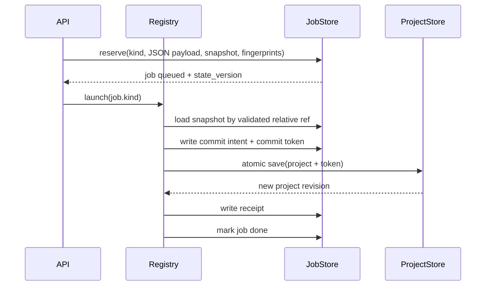

# M1 — Job schema, registry và commit journal

Ngày triển khai: 02/10/2026 (Asia/Saigon).

## Đã triển khai

- Job JSON có schema/operation version, payload, input/config fingerprint, input revision, snapshot reference, attempt, state version, steps, error envelope, commit token và resume capability. Payload phải serialize được thành JSON trước khi nhận job.
- Snapshot dự án được ghi nguyên tử dưới `data/job_runs/<job-id>/snapshot.json`; fingerprint SHA-256 dùng JSON canonical. Fingerprint cấu hình chỉ lấy các trường profile/model/voice/ASR/renderer được phép, không đưa API key, URL hay secret vào dữ liệu job.
- Backend dùng registry `kind -> handler`. Các loại project job, assistant, upload và demo đều dispatch từ kind + payload. Prompt assistant chỉ được giữ trong RAM trong lượt chạy; job bền chỉ chứa fingerprint prompt, nên job assistant cũ luôn restart-only.
- Commit ghi `commit-intent.json`, thêm token vào project JSON cùng lần ghi atomic, rồi ghi `receipt.json`. Token được bảo toàn khi undo/redo ghi lại project, độc lập với history. Startup nạp job trước khi cleanup staging và khôi phục job thành done nếu token/receipt chứng minh commit đã xảy ra.
- Job JSON cũ được nâng lên schema 1 khi đọc. Job cũ không có snapshot/payload được gắn `resume_capability: restart_only`; job active cũ thành `interrupted`, không tự chạy lại.
- Lỗi job mới lưu envelope code/category/message/severity/job/step/retryable/actions/diagnostic/safe details/time, đồng thời giữ `message` và `detail` cho client cũ.
- Project schema nâng từ 5 lên 6 để lưu `job_commit_tokens`; migration thêm danh sách rỗng mặc định cho project cũ. Backup schema cũ hiện có bảo toàn bytes trước lần ghi nâng schema đầu tiên.

## Giới hạn còn lại

Các giới hạn dưới đây mô tả trạng thái ở cuối M1; checkpoint render và resume được bổ sung trong [M2](M2.md).

- Snapshot và journal đã bền nhưng các handler hiện đặt `resume_capability: restart_only`; chưa có manifest/checkpoint từng bước. Nút tiếp tục chưa được thêm.
- Assistant cần gửi lại sau khi backend restart vì prompt không được ghi xuống đĩa. Upload nhận đủ file được đưa vào handler registry, nhưng resume sau restart vẫn restart-only.
- Asset fingerprint hiện dựa trên snapshot JSON/asset ID, chưa có hash nội dung media trong manifest. M2/M3 sẽ thêm xác thực checkpoint và dấu hash media.
- Error envelope hiện áp dụng cho lỗi job bất đồng bộ. HTTP errors đồng bộ vẫn giữ `{detail: ...}`; chuyển đổi API rộng hơn thuộc trung tâm lỗi.
- Bộ kiểm thử tự động không được chạy trong lượt này theo chỉ dẫn tác vụ. M0 fixture là hợp đồng cho bước nghiệm thu tiếp theo.

## Luồng dữ liệu

## Kiểm tra thực hiện

- Chưa chạy pytest hoặc frontend suite.
- Sẽ chạy cú pháp Python và kiểm tra diff trước khi bàn giao; đây không thay cho nghiệm thu recovery/fault injection.
